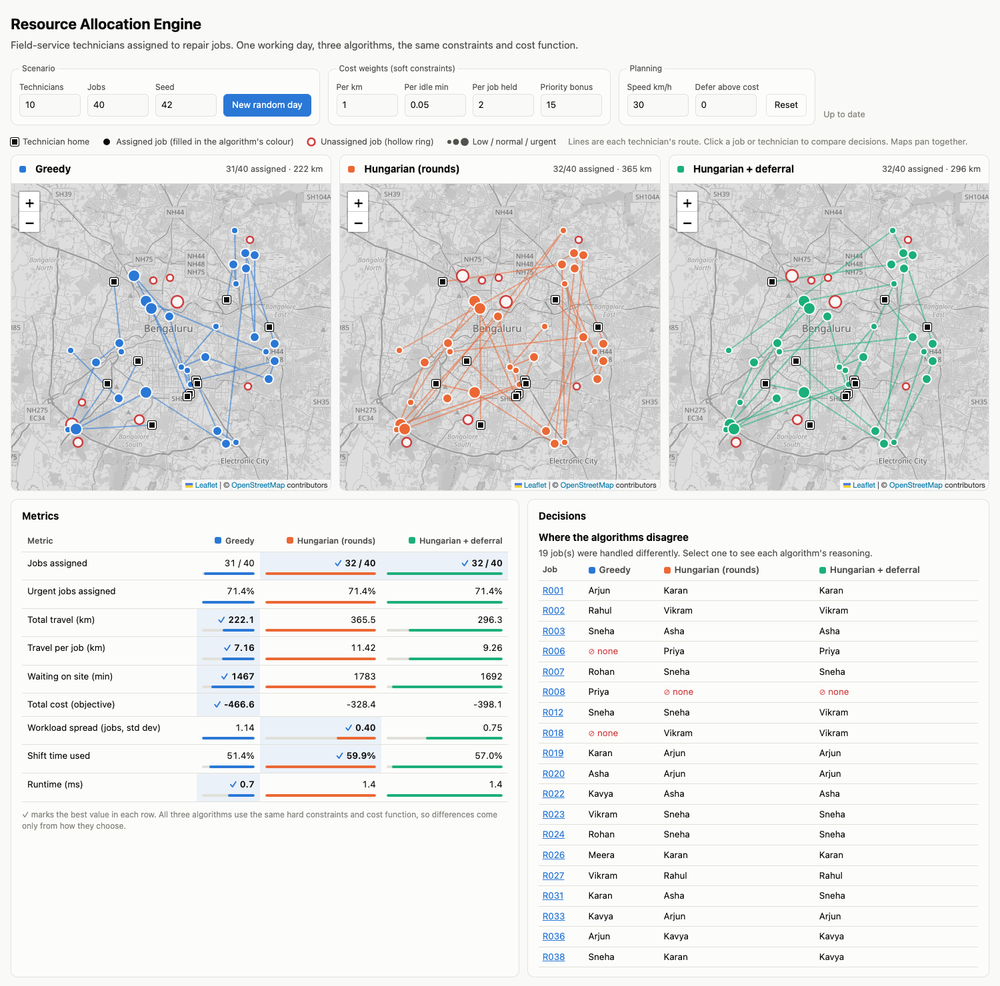

# Resource Allocation Engine

Assigns **field-service technicians to repair jobs** across one working day and compares three allocation
algorithms side by side. Each technician has skills, a shift and a home location, and each job has an SLA
window. The engine picks who does which job and when, explains every decision, and reports metrics.
A React UI shows the three plans on synced maps.



- [Quick start](#quick-start)
- [Problem and data model](#problem-and-data-model)
- [Constraints and cost](#constraints-and-cost)
- [Algorithms](#algorithms)
- [Analysis: what comparing them showed](#analysis-what-comparing-them-showed)
- [User interface](#user-interface)
- [API](#api)
- [Tests](#tests)
- [Project structure](#project-structure)
- [Assumptions and limitations](#assumptions-and-limitations)

## Quick start

Requirements: **Python 3.11+** and **Node 18+**. No API keys or paid services are used. The map tiles come
from OpenStreetMap, so the map background needs an internet connection; everything else runs offline.

**1. Backend** (FastAPI, port 8000)

```bash
cd backend
python3 -m venv .venv
source .venv/bin/activate          # Windows: .venv\Scripts\activate
pip install -r requirements.txt
uvicorn app.main:app --port 8000
```

**2. Frontend** (React + Vite, port 5173), in a second terminal

```bash
cd frontend
npm install
npm run dev
```

Open **http://localhost:5173**. The dev server forwards `/api` calls to the backend, so no CORS setup is
needed. Interactive API docs are at http://localhost:8000/docs.

**3. Tests and benchmark**

```bash
cd backend
pytest                 # 103 tests
python benchmark.py    # regenerates the comparison table below (30 random scenarios per size)
```

## Problem and data model

**Domain: field service.** A company has technicians with different skills spread across a city
(Bengaluru in the generated data). Customers raise repair jobs that need certain skills and must be started
within an SLA window. The goal is to plan the day: assign as many jobs as possible, urgent ones first,
while keeping driving and idle time low.

| Entity | Fields | Notes |
|---|---|---|
| `Technician` | id, name, skills, home location, shift start/end | The resource. Can do **several jobs in sequence** during the shift. |
| `Request` | id, location, required skills, duration, earliest start, latest start (SLA deadline), priority 1–3 | The job. Must *start* inside its window. |
| `Assignment` | request, technician, start, end, extra km, travel and idle minutes, cost, **explanation** | The output pairing, with a plain-English reason. |
| `Unassigned` | request, **reason** | Every job the plan leaves out says why. |
| `TechnicianState` | technician, ordered list of scheduled jobs | Planning-time state. The `Technician` record itself is never changed. |

Times are minutes since midnight (540 = 09:00), which keeps the scheduling arithmetic simple.
Scenarios come from a generator with a fixed seed, so the same seed always produces the same day.

### Availability is time-based, not on/off

A technician who is busy at 10:00 is not removed from consideration. They may still be able to take a job
whose window falls later in the day. For each (technician, job) pair the engine looks at **every gap** in the
technician's current schedule:

1. Leave from the previous job (or from home at shift start).
2. Drive to the new job and start at `max(arrival, window opens)`.
3. Check the start is before the SLA deadline and the job ends before the shift does.
4. Check the technician can still reach the **next** already-scheduled job on time.

The cheapest feasible gap wins. Being able to insert into gaps turned out to matter a lot (see
[Analysis](#analysis-what-comparing-them-showed)).

## Constraints and cost

All of this lives in one function, `evaluate()` in [`backend/app/scheduling.py`](backend/app/scheduling.py),
which **every algorithm calls**. The algorithms therefore differ only in *how they choose*, never in what they
consider feasible or cheap, so the comparison is fair.

**Hard constraints** (a violation makes the pair infeasible):

- The technician has **all** required skills.
- The job starts no later than its SLA deadline.
- The job finishes before the technician's shift ends.
- Jobs do not overlap, and there is enough travel time between consecutive jobs.

**Soft constraints** (combined into a cost; lower is better):

```
cost = 1.0  × extra km driven
     + 0.05 × minutes waiting on site for the window to open
     + 2.0  × jobs the technician already has     (spreads work out)
     − 15   × priority                            (urgent jobs win scarce technicians)
```

All four weights, the travel speed and the deferral threshold can be changed in the UI.

## Algorithms

### 1. Greedy (baseline)

Sort jobs by priority (urgent first), then by deadline. For each job in turn, give it to the cheapest
technician who can still fit it. Earlier decisions are never revisited.

*Explanation example:* "Processed #36 in queue (priority 1). Chose Asha (adds 7.9 km to route, starts 15:00,
cost 7.1), the cheapest of 2 feasible technician(s); next best was Sneha (cost 14.0)."

### 2. Hungarian in rounds

The Hungarian (Kuhn–Munkres) algorithm finds the minimum-cost **one-to-one** matching, using
`scipy.optimize.linear_sum_assignment`. A technician can do several jobs a day, so it runs in rounds:

1. Build a cost matrix of open jobs × technicians in their current state. Infeasible pairs get a huge cost.
2. Solve it, and commit every feasible pair. Each technician gets at most one new job per round.
3. Update the schedules and repeat until a round assigns nothing.

Within a round all decisions are made **jointly**, so the algorithm does not use up the only HVAC technician
on an electrical job that someone else could do.

*Explanation example:* "Round 1 batch match (10 pairs solved jointly). Assigned Asha (…). Individually
cheapest was Sneha (cost -26.0), but they went to R007 because that lowered the round's total cost."

### 3. Hungarian + deferral

The basic version has a flaw: because it maximises the number of pairs in every round, each technician takes
a job each round **even when the only job left for them is a long detour**. The deferred version adds a
"not this round" option for each job, costing `defer_cost` (default 0). The solver declines any match that is
more expensive than waiting. If a round with that option assigns nothing, a normal round runs, so a feasible
job is never dropped; poor matches are simply made last, when they can no longer block better ones.

### Why not other algorithms?

- **CP-SAT / MIP** (e.g. OR-Tools) would solve the whole day exactly, but it is heavier to model and to run.
  With rounds, Hungarian already shows the greedy-versus-batch trade-off the assignment asks about.
- **ML** was ruled out because there is no historical data to learn from, and this is an optimisation
  problem rather than a prediction problem.

## Analysis: what comparing them showed

Averages over 30 random scenarios per size (`python benchmark.py`). Runtimes depend on the machine.

| Scenario | Algorithm | Assigned | Urgent assigned | Travel km | Total cost | Load std dev | Runtime ms | More jobs than greedy |
|---|---|---|---|---|---|---|---|---|
| 20 techs / 60 jobs (plenty) | greedy | 55.6 | 96.6% | **390** | -931 | 1.47 | 2.0 | – |
| | hungarian | **57.5** | 97.0% | 447 | -891 | **0.49** | 3.4 | 23/30 |
| | hungarian_deferred | 57.0 | 97.0% | 393 | **-940** | 0.85 | 3.9 | 19/30 |
| 10 techs / 40 jobs (balanced) | greedy | 32.4 | **94.2%** | 291 | -501 | 1.28 | 0.8 | – |
| | hungarian | **32.5** | 93.2% | 284 | -504 | **0.72** | 1.6 | 11/30 |
| | hungarian_deferred | 32.2 | 92.9% | **266** | **-518** | 0.88 | 1.9 | 10/30 |
| 8 techs / 60 jobs (scarce) | greedy | **34.5** | **87.3%** | 332 | -600 | 0.91 | 1.1 | – |
| | hungarian | 34.1 | 85.2% | 266 | -632 | **0.77** | 3.5 | 13/30 |
| | hungarian_deferred | 34.1 | 85.2% | **265** | **-633** | 0.83 | 4.2 | 13/30 |

### What I learned

**1. Batch matching wins when jobs compete for the same scarce skill.** This is the classic case greedy gets
wrong, and there is a test that reproduces it
(`test_greedy_strands_job_when_it_uses_scarce_skill_first`). Greedy handles an urgent electrical job first,
gives it to the nearest technician (the only one who also knows HVAC), and the HVAC job is then stranded.
Hungarian sees both jobs at once and sends a different electrician. With plenty of technicians,
Hungarian assigns more jobs than greedy in 23 of 30 scenarios and fewer in none.

**2. When capacity is scarce, the advantage largely disappears.** With 8 technicians for 60 jobs,
greedy assigns slightly more jobs and more urgent jobs. When most jobs cannot be served anyway,
there are few clever swaps left to find, and greedy's strict "urgent first" order protects urgent jobs better
than Hungarian's priority bonus inside the cost. Hungarian still drives about 20% less.

**3. Optimal per round does not mean optimal for the day.** Each Hungarian round is solved exactly, but the
rounds themselves are greedy in time. Basic Hungarian therefore made avoidable detours and, with plenty of
technicians, drove 15% more than greedy. Deferral fixed this: 447 km fell to 393 km while keeping most of the
coverage gain. Deferral gave the lowest total cost in every setting. On some individual scenarios, including
the default seed shown in the screenshot, greedy still has the lowest cost, which is a reminder that none of
these is a global optimum.

**4. Scheduling model matters as much as the algorithm.** In my first version jobs could only be *appended*
to a technician's day. Then the order of commits decided everything: an urgent 15:00 job assigned first
wiped out the technician's whole morning, and Hungarian did *worse* than greedy. Allowing a job to be
inserted into any gap raised average coverage by 1.5 to 6.6 jobs per scenario for both algorithms, most when
technicians were scarce. That was a bigger gain than switching algorithms.

**5. Balance comes free with batch matching.** Hungarian gives each technician at most one job per
round, so it spreads work evenly (load std dev 0.49 vs 1.47). That is good for fairness but costs extra
driving. The workload weight in the cost function controls this trade-off for every algorithm.

**6. Cost is small at this size.** Batch matching takes 2–4× as long as greedy, but stays under 5 ms for
60 jobs. Each round is O(n³) on the matrix, so for thousands of jobs I would partition by region or time.

**When to use which:** use **greedy** when decisions must be made instantly as each job arrives, or when
strict priority order is a business rule. Use **Hungarian + deferral** for planning in batches, such as the
night before, when capacity is reasonably sized and skills are scarce. That is where batch matching
pays off most.

## User interface

- **Controls:** scenario size and seed, the four cost weights, travel speed and the deferral threshold. Any
  change re-runs all three algorithms.
- **Three synced maps** (Leaflet + OpenStreetMap), one per algorithm. Squares are technician homes, filled
  circles are assigned jobs, hollow red rings are unassigned jobs, marker size shows priority, and lines show
  each technician's route through the day. Panning one map pans all three.
- **Metrics table:** every metric side by side, with the best value in each row marked.
- **Decisions panel:** lists the jobs where the algorithms disagree. Click a job (in the list or on a map) to
  read each algorithm's decision and explanation, or click a technician to compare their day under each
  algorithm, with their route highlighted on all three maps.

Each technician does not get their own colour, because there are more technicians than colours that stay
distinguishable (including for colour-blind viewers); a clicked technician is highlighted instead. The three
algorithm colours come from a palette checked for colour blindness and always appear next to the
algorithm's name. The UI supports light and dark mode and narrow screens.

## API

| Method | Path | Purpose |
|---|---|---|
| GET | `/api/scenario?technicians=10&requests=40&seed=42` | Generate a reproducible scenario |
| POST | `/api/allocate` | Run algorithms. Body: `{ "scenario": …, "config": …, "algorithms": ["greedy", …] }`. `config` and `algorithms` are optional. |
| GET | `/api/algorithms` | List algorithm names |
| GET | `/api/health` | Health check |

`/api/allocate` accepts any scenario, not only generated ones, so custom data can be posted directly.

## Tests

`cd backend && pytest` runs 103 tests:

- **Scheduling rules** (`test_scheduling.py`): skills, SLA deadline, shift end, waiting for a window to open,
  inserting a job before a later one, and rejecting an insertion that would make the next job late.
- **Validity on random scenarios** (`test_algorithms.py`): every algorithm runs on 24 generated scenarios, and
  an **independent checker** re-derives every hard constraint from the raw data, without using the engine's
  own feasibility code.
- **Hand-built comparisons:** greedy strands a scarce-skill job that Hungarian serves; basic Hungarian makes a
  28 km detour that the deferred version avoids; with no competition, all algorithms agree.
- **Explanations and reasons:** unassigned jobs are told apart as "no one has the skill", "can't arrive before
  the SLA", "would overrun the shift" and "capacity ran out".
- **API:** allocation end to end, and rejection of unknown algorithm names.

## Project structure

```
backend/
  app/
    models.py           data model (Pydantic)
    scheduling.py       feasibility check and cost function shared by all algorithms
    geo.py              distance and travel time
    generator.py        reproducible synthetic scenarios
    algorithms/
      greedy.py
      hungarian.py      basic and deferred variants
      common.py         metrics, unassigned reasons, result assembly
    main.py             FastAPI app
  tests/
  benchmark.py          algorithm comparison over many scenarios
  requirements.txt
frontend/
  src/
    App.jsx             state, data fetching, layout
    components/         Controls, AllocationMap, MetricsTable, DetailPanel
    theme.js            colours and formatting helpers
  package.json
docs/screenshot.png
```

## Assumptions and limitations

- **Straight-line distance** at a fixed average speed (30 km/h by default), not road routing. Every
  algorithm sees the same distances, so the comparison stays fair.
- Technicians do not need to drive home at the end of their shift.
- Once a job is placed, its start time is fixed. Later insertions must fit around it rather than shift it.
- A job needs one technician; team jobs are not modelled.
- The plan is made once for the whole day. Real-time re-planning (cancellations, new urgent jobs, overruns)
  is not modelled, although the API could be called again with the remaining jobs.
- None of the algorithms is a global optimum for the full day. A CP-SAT model would be the natural next step
  to measure how far from optimal each one is.
